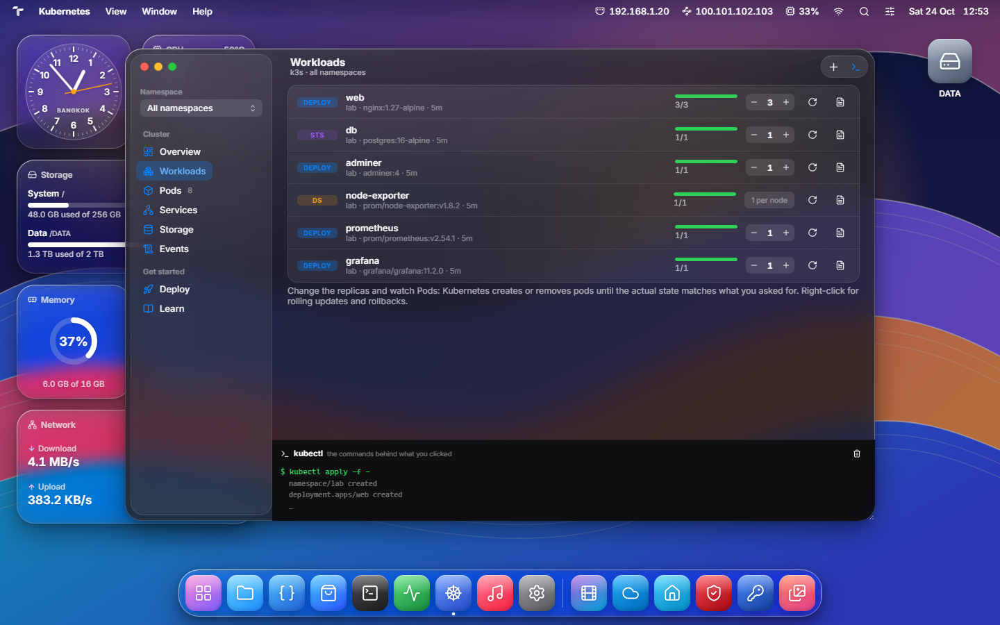

# TemanLabsOS

**Web desktop untuk home server Ubuntu.** Kelola container Docker, cluster Kubernetes, file, layanan sistem, dan jaringan dari browser, lewat tampilan desktop dengan jendela, Dock, dan efek kaca, tanpa harus membuka terminal.

TemanLabsOS jalan berdampingan dengan [CasaOS](https://casaos.zimaspace.com/) (port 80) di port **7700**, dan dikirim sebagai **satu file binary** (backend Go dengan frontend React yang sudah di-embed).


**Mulai:** [Panduan instalasi →](docs/installation.md)

---

## Daftar isi

- [Fitur](#fitur)
- [Arsitektur](#arsitektur)
- [Struktur proyek](#struktur-proyek)
- [Lab Kubernetes](#lab-kubernetes)
- [Keamanan](#keamanan)
- [Dokumentasi](#dokumentasi)
- [Kredit](#kredit)

---

## Fitur

### Desktop
- **Dock**, **Launcher** (semua app, bisa dikelompokkan ke folder), **Quick Search** (`Ctrl/⌘ + K`), dan menu bar yang isinya mengikuti app yang sedang aktif.
- **Widget desktop**: jam, CPU, memori, storage, jaringan, dan app yang berjalan. Ukuran dan urutannya bisa diatur.
- Jendela bisa digeser, di-resize, diperkecil, dan di-zoom, lengkap dengan animasi. Ada tema terang/gelap, wallpaper dari foto sendiri, dan opsi *Reduce transparency* untuk perangkat yang lambat.


### Container & orkestrasi
| App | Fungsi |
|---|---|
| **App Center** | Katalog app self-hosted (Jellyfin, Nextcloud, Vaultwarden, Home Assistant, dll.) yang dipasang lewat `docker compose`, plus **Custom Install** untuk image Docker apa pun (port, volume, env, restart policy). |
| **System Monitor** | Container (CPU, memori, network, disk per container), layanan systemd, proses, dan port yang sedang listening. |
| **Kubernetes** | Install k3s sekali klik, lalu kelola Deployment, StatefulSet, DaemonSet, Pod, Service, PVC, dan Event. Ada fitur scale, rolling update/rollback, logs, describe, YAML, template **Lab Stack** (web + database + monitoring), dan panel yang menampilkan perintah `kubectl` di balik setiap klik. |



### File & media
- **Files**: tampilan ikon, list, dan detail; thumbnail foto/video; drag & drop dan upload file/folder dari komputer; copy/cut/paste; rename; hapus.
- **Code**: editor berbasis Monaco (mesin editor VS Code), dengan explorer, search, tab, dan terminal terintegrasi.
- **Image Viewer**, **Video Player**, dan **Music Player** (navigasi pakai tombol panah).
- **File Sharing**: share folder via SMB (Samba) dan kelola user Samba dari web.


### Utilitas server
| App | Fungsi |
|---|---|
| **Terminal** | Shell penuh di browser (xterm.js + PTY). |
| **System Updates** | Update paket `apt`, dengan log langsung dan notifikasi kalau perlu restart. |
| **Log Viewer** | Journal systemd, difilter per kategori atau per service. |
| **Disk Manager** | Drive dan partisi, kesehatan SMART, mount, dan analisis pemakaian ruang. |
| **Network Tools** | Interface, ping, traceroute, DNS lookup, koneksi aktif, dan firewall (ufw). |
| **Scheduled Tasks** | Cron job per user dan timer systemd. |
| **Settings** | Tampilan, akun, user & grup Linux, tanggal & zona waktu. |


---

## Arsitektur

```
Browser ──HTTP/WebSocket──▶ temanlabsos (Go, :7700, systemd, root)
                              ├─ frontend React (embedded)
                              ├─ REST API /api/*  ·  terminal /ws/terminal
                              ├─ Docker Engine ──▶ container (app CasaOS & App Center)
                              ├─ k3s / kubectl ──▶ cluster Kubernetes (opsional)
                              └─ tool sistem: systemctl, journalctl, apt, ufw, smbd, lsblk, …
```

- **Frontend**: React 19 + TypeScript + Vite, ikon dari [Lucide](https://lucide.dev/), font Inter.
- **Backend**: Go (standard library `net/http`), WebSocket untuk terminal, tanpa database. Konfigurasi disimpan di satu file JSON.
- App web yang berjalan di server dibuka di dalam jendela lewat *frame proxy* (port 7710–7799), sehingga app yang menolak dibuka di iframe tetap bisa tampil.

Detail lebih lengkap, termasuk daftar endpoint API, ada di [docs/architecture.md](docs/architecture.md).

---

## Struktur proyek

```
├─ src/                     Frontend (React + TypeScript)
│  ├─ App.tsx               Desktop: jendela, Dock, Launcher, menu bar
│  ├─ api/                  httpApi.ts (server sungguhan), mockApi.ts + mockSystem.ts (data contoh), types.ts
│  ├─ components/           Shell: Window, Dock, Launcher, QuickSearch, MenuBar, Glass, widget, dialog
│  ├─ windows/              Isi tiap app: Files, Kubernetes, SystemMonitor, AppCenter, Terminal, …
│  ├─ hooks/  lib/          State, helper, template Kubernetes, pengaturan
│  └─ styles/               base.css (token tema), glass.css (efek kaca), app.css (layout)
├─ server/                  Backend Go: satu file per area (docker.go, k8s.go, files.go, smb.go, …)
├─ deploy/install.sh        Installer systemd
├─ scripts/build-server.mjs Build frontend → embed → cross-compile binary Linux
└─ docs/                    Dokumentasi dan screenshot
```

---

## Lab Kubernetes

TemanLabsOS bisa dipakai untuk belajar **container orchestration**: install k3s dari app Kubernetes, deploy **Lab Stack** (web nginx 3 replika, PostgreSQL dengan persistent volume, Prometheus + Grafana), lalu coba scaling, self-healing, rolling update, dan monitoring.

Panduan langkah demi langkah ada di **[docs/kubernetes-lab.md](docs/kubernetes-lab.md)**, termasuk perintah `kubectl` yang setara untuk laporan.

---

## Keamanan

TemanLabsOS memberi akses penuh ke server, jadi perlakukan seperti akses root.

- Service berjalan sebagai **root** (seperti CasaOS), karena memang mengelola Docker, paket, user, disk, dan firewall. Terminal tetap login sebagai user Linux biasa.
- **Login**:
  - Password di-hash dengan PBKDF2-SHA256.
  - Session cookie `HttpOnly` dan `SameSite=Lax`, berlaku 30 hari.
  - IP dikunci sementara setelah 8 kali gagal login dalam 10 menit.
- Request dengan `Origin` dari situs lain ditolak (perlindungan CSRF).
- Folder sistem (`/etc`, `/usr`, `/boot`, …) tidak bisa dihapus atau di-rename dari UI. User dan service penting juga dilindungi dari penghapusan.
- Server **tidak memakai HTTPS sendiri**. Jangan buka port 7700 langsung ke internet. Akses lewat LAN, VPN (mis. Tailscale), atau reverse proxy dengan TLS.
- Password contoh di template Lab Kubernetes (`admin/admin`, `lab-password`) hanya untuk belajar. Ganti dulu kalau cluster-nya bisa diakses orang lain.

---

## Dokumentasi

| Dokumen | Isi |
|---|---|
| [docs/installation.md](docs/installation.md) | Persyaratan, instalasi dan update, konfigurasi, development, troubleshooting |
| [docs/kubernetes-lab.md](docs/kubernetes-lab.md) | Lab container orchestration: web, database, monitoring di Kubernetes |
| [docs/architecture.md](docs/architecture.md) | Cara kerja frontend dan backend, menambah app, daftar endpoint API |

---

## Kredit

TemanLabsOS adalah proyek independen dan tidak berafiliasi dengan vendor sistem operasi mana pun. Nama dan logo app pihak ketiga di App Center (Jellyfin, Nextcloud, dll.) adalah milik pemiliknya masing-masing. Ikon app diambil dari [selfh.st/icons](https://selfh.st/icons/).

Dibangun dengan: [React](https://react.dev/), [Vite](https://vite.dev/), [Lucide](https://lucide.dev/), [Inter](https://rsms.me/inter/), [Monaco Editor](https://microsoft.github.io/monaco-editor/), [xterm.js](https://xtermjs.org/), [coder/websocket](https://github.com/coder/websocket), [creack/pty](https://github.com/creack/pty), dan [k3s](https://k3s.io/).
