<div align="center">

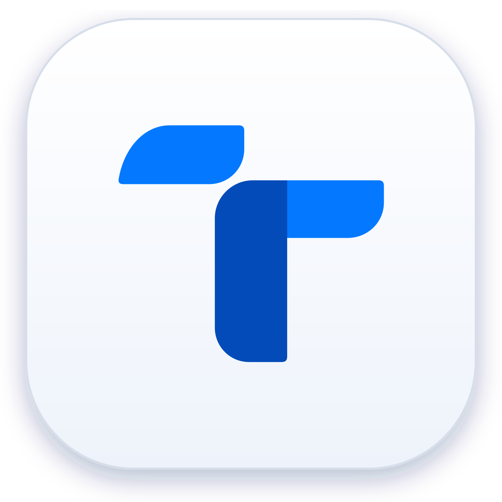

# TemanLabsOS

**A web desktop for your Ubuntu home server**

Manage Docker, files, backups, storage, services, the network and the other computers in your home from the browser, through a polished desktop, without opening a terminal.

**English** &nbsp;|&nbsp; [Bahasa Indonesia](README.id.md)

<p>
  
  
  
  
</p>
<p>
  
  
  
</p>
<p>
  <a href="https://github.com/diopratama99/TemanLabs-OS/commits"></a>
  
  <a href="https://github.com/diopratama99/TemanLabs-OS/stargazers"></a>
</p>

[**Install**](docs/installation.md) &nbsp;•&nbsp; [**From TrueNAS**](docs/migrate-truenas.md) &nbsp;•&nbsp; [**Features**](#features) &nbsp;•&nbsp; [**Screenshots**](#screenshots) &nbsp;•&nbsp; [**Architecture**](docs/architecture.md) &nbsp;•&nbsp; [**API**](docs/architecture.md#api-endpoints)

<br />

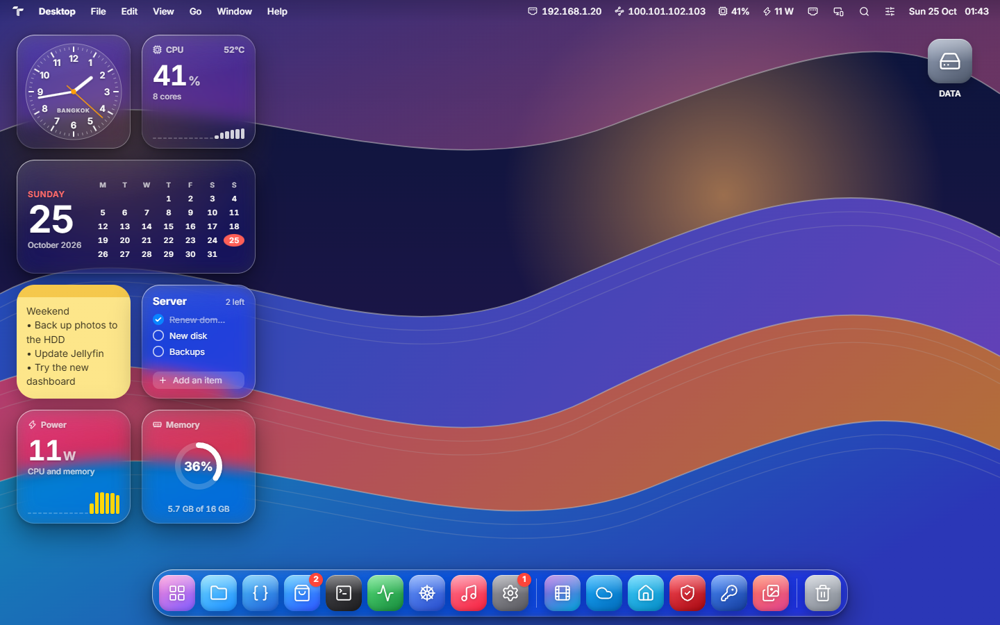

</div>

<br />

## Highlights

<table>
  <tr>
    <td align="center" width="33%">
      <br />
      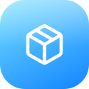
      <p><b>One binary</b><br /><sub>Go with the React desktop embedded. Copy one file, run the installer.</sub></p>
      <br />
    </td>
    <td align="center" width="33%">
      <br />
      
      <p><b>Hundreds of apps</b><br /><sub>An App Center with a page for every app, and one-click updates.</sub></p>
      <br />
    </td>
    <td align="center" width="33%">
      <br />
      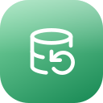
      <p><b>Backups built in</b><br /><sub>Apps and folders to a disk or cloud drive, encrypted, any version restorable.</sub></p>
      <br />
    </td>
  </tr>
  <tr>
    <td align="center" width="33%">
      <br />
      
      <p><b>Watches your apps</b><br /><sub>Checked every minute, restarted when stuck, with 30 days of history.</sub></p>
      <br />
    </td>
    <td align="center" width="33%">
      <br />
      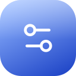
      <p><b>Docker without a terminal</b><br /><sub>Ports, folders, variables, updates, shells and startup, all from forms.</sub></p>
      <br />
    </td>
    <td align="center" width="33%">
      <br />
      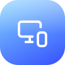
      <p><b>Your other computers</b><br /><sub>Wake-on-LAN from anywhere, and their screens in a window.</sub></p>
      <br />
    </td>
  </tr>
  <tr>
    <td align="center" width="33%">
      <br />
      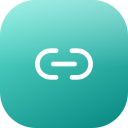
      <p><b>Share with a link</b><br /><sub>Downloads or file drops for anyone, with an expiry and a password.</sub></p>
      <br />
    </td>
    <td align="center" width="33%">
      <br />
      
      <p><b>Ad blocking for the home</b><br /><sub>Ads, trackers and gambling sites blocked on every device on the Wi-Fi.</sub></p>
      <br />
    </td>
    <td align="center" width="33%">
      <br />
      
      <p><b>Secure by default</b><br /><sub>Hashed passwords, a lock screen, and saved secrets kept on the server.</sub></p>
      <br />
    </td>
  </tr>
</table>

## Quick start

One command on an Ubuntu or Debian server (amd64 or arm64):

```bash
curl -fsSL https://github.com/diopratama99/TemanLabs-OS/releases/latest/download/install.sh | sudo bash
```

The installer downloads the latest release, checks its checksum, installs Docker if it's missing and runs TemanLabsOS as a service. Open the address it prints, `http://<server-ip>`, and sign in with the `INITIAL_PASSWORD` it prints too. It takes port 80 so no port is needed; if something else already has port 80 (CasaOS, nginx…), it uses `:7700` instead. Later versions install from **Settings → General → Software Update**.

The full guide (requirements, updating, configuration, development, troubleshooting) is in **[docs/installation.md](docs/installation.md)**.

## Features

### Desktop
- **Dock** with smooth adding, reordering and removing (drag apps in from the Launcher), badges for waiting updates, and a **Trash** at its end. A floating **Launcher** with categories, recently used apps and folders, **Quick Search** (`Ctrl/⌘ + K`), and a menu bar that follows the app in front.
- **Status bar** items you can click: processor (top processes), power draw in watts, network (IP addresses, speeds), **My Devices** (wake them from there), and the date with a calendar. **Quick Settings** has tiles for dark mode, ad blocking, Tailscale, lock and more.
- **About This Server**: the machine's model (read from its firmware, or "Virtual server" on a VPS), processor, memory and serial number.
- **Desktop widgets**: clock, CPU, memory, storage, network, apps, power, server, calendar, **sticky notes** and **to-do lists**.
- Windows can be moved, resized from any edge, minimised, **snapped** to halves, quarters or thirds, and made **full screen**, with smooth animations. Light and dark themes, an accent color, your own photos as wallpaper, and a glass effect you can turn off.
- A **lock screen** (by hand or after a while away), and a list of the browsers signed in, to sign any out.
- Works on a phone too: full-screen windows, sidebars become tabs, and the Dock scrolls.
- The interface is available in **English** and **Bahasa Indonesia**.

### Apps & containers
| App | What it does |
|---|---|
| **App Center** | Hundreds of apps from community app stores (the official store and BigBear, and you can add more). Every app has **its own page** with screenshots, a description, tips and what it sets up (image, ports, data folders), then lets you adjust the settings before it installs. **Custom Install** takes any image or compose file. **Updates** checks for newer images, with **Update All**. |
| **App Settings** | For every Docker app, however it was installed (App Center, your own compose file, `docker run`): change ports, volumes, variables and the image in a form or as YAML; logs; a shell inside the container; update; uninstall (optionally with its data). |
| **Settings → Applications** | Every installed app on one page: start and stop, its address, **whether it starts with the server**, updates, and its **health**: responding or not, uptime over 24 hours, 7 and 30 days, past outages, and **restart when it stops responding**. A Node.js app run by pm2 can **move into Docker** (same files, Node version and user; put back by itself if it doesn't answer), and back. |
| **App windows** | Apps open in their own window. Apps that refuse to be embedded are shown through a built-in proxy, and apps behind an HTTP Basic login (such as Supabase Studio) are **signed in from the window** instead of the browser's dialog. |
| **System Monitor** | CPU, memory, network and disk per container, systemd services, processes and listening ports, and **History**: an hour to 30 days of CPU, memory, temperature, network, disk and power, with the busiest moments. |
| **Kubernetes** | Install k3s, then manage Deployments, StatefulSets, DaemonSets, Pods, Services, PVCs and Events: scale, rolling update and rollback, logs, describe and YAML. |

### Files & media
| App | What it does |
|---|---|
| **Files** | Icon, list and gallery views, photo and video thumbnails, drag and drop, file and folder uploads, copy/cut/paste, **Open With**, and **Get Info** in its own window. **Recents**, color **Tags**, and a **Trash** you can put things back from (each disk has its own, so even big folders move there at once; emptied after 30 days). |
| **Share links** | Right-click a file or folder → **Share Link…** to let anyone download it (a folder as browsable files or a zip), or a folder → **Request Files…** to let anyone send files into it without seeing what's there. Links can expire and have a password. |
| **Code** | A Monaco-based editor (the editor inside VS Code) with an explorer, search, tabs and a terminal. |
| **Image Viewer · Video Player · Music Player** | Open media straight from Files and step through it with the arrow keys. The Video Player has its own controls (10-second skips, speed, full screen) and **continues where you left off**, on any device. |
| **Remux** | Change video and sound formats on the server with ffmpeg: remux to MP4, MKV or TS in seconds without losing quality, convert to H.264, H.265, VP9 or AV1, resize, or keep just the sound (MP3, M4A, FLAC), with a queue and progress. |
| **Downloader** | Paste links from YouTube, Instagram, X, TikTok, Facebook, Reddit and hundreds of other sites to save the video (up to the quality you pick), just the sound as MP3, or the photos of a post, straight onto the server, with a queue and progress. Whole playlists and profiles work too, or **Choose Items…** shows what's on a profile, channel or playlist as thumbnails to pick from. Save to a folder on the server or **straight to the device you're using**, and a **cookies.txt** opens posts that need an account. Built on [yt-dlp](https://github.com/yt-dlp/yt-dlp) and [gallery-dl](https://github.com/mikf/gallery-dl), installed with one click and updated from the app. |
| **Downloader → Live Streams** | Add channels from Twitch, YouTube, Kick, TikTok and the other sites [streamlink](https://streamlink.github.io/) knows. They're checked every couple of minutes and **recorded from the moment they go live** until the stream ends, then saved as MP4 in a folder per channel. Pick the quality and the folder, record by hand, and keep recordings for a set number of days. Recordings carry on through a restart or update of TemanLabsOS. |
| **File Sharing** | Share folders over SMB (Samba) and manage its users from the web. |

### Backup & the network
| Where | What it does |
|---|---|
| **Settings → Backup** | Backup plans with [restic](https://restic.net/): **every app's settings and data** (their compose folders and mounts, found from Docker) plus any folders, to another disk or a cloud drive (Google Drive and the others rclone connects), daily, weekly or by hand. Apps can be paused while they're copied so databases stay in one piece. Browse any version and restore files to where they came from (the apps involved are stopped meanwhile) or into a new folder. A **recovery key** reads the backups on a reinstalled server. |
| **Settings → Ad Blocking** | AdGuard Home for the whole home: three strengths, plus lists for gambling sites, pop-up ads, phone makers' built-in ads and Indonesian ad servers, statistics per device, an allow list, and steps for when ads still get through. |
| **Settings → Remote Access** | Reach the server from anywhere with Tailscale, step by step. |

### Server tools
| App | What it does |
|---|---|
| **Devices** | The other computers on your network: on/off status, **Wake-on-LAN** to switch them on from anywhere, a network scan that finds them by name, and their **screens in a window** over VNC or RDP. The remote desktop engine runs in a small container that only the server itself can reach. |
| **Terminal** | A full shell in the browser (xterm.js + PTY). |
| **Terminal → Commands** | Beside the Terminal (the book button): hundreds of terminal commands for Ubuntu and the tools you have (Docker, Compose, Kubernetes, ffmpeg, rclone, git…), commands for every installed app, your shell history and your own saved commands. Search in plain words (“see which ports are open”), fill in the blanks and send it to the Terminal. |
| **Disk Manager** | Drives, partitions, SMART health, mounting and **mount at startup**, **formatting** (ext4, xfs, btrfs, exFAT, NTFS), space analysis, **merged storage** (mergerfs), USB auto-mount and eject, **cloud drives** through rclone, and **ZFS pools**: import one from TrueNAS (read-only first), its health, scrubs and daily snapshots. See [Moving from TrueNAS SCALE](docs/migrate-truenas.md). |
| **Settings → Software Update** | TemanLabsOS's own updates, app updates, and the system's `apt` updates with a live log and a notice when a restart is needed. |
| **System Monitor → Logs** | The systemd journal by category or by service. |
| **Network** | An overview of the internet, its speed, the routers and this server's addresses, and the tools: interfaces, ping, traceroute, DNS, active connections and the firewall (ufw). |
| **Network → Routers** | The modem, routers and access points, checked every 30 seconds: which one is down, whether the internet is, uptime and outages. Restart one over SSH (MikroTik, OpenWrt) or with its smart plug (Tasmota, Shelly), by hand or by itself, with what to check by hand when that doesn't help. |
| **Network → Speed Test** | The internet's download, upload, ping and jitter, by hand or on a schedule, kept for 180 days: compared with your plan, the hours it slows down, and a CSV to send the ISP. Tested with Cloudflare (built in) or Ookla's Speedtest, whose results get a speedtest.net link. |
| **Scheduled Tasks** | Per-user cron jobs and systemd timers. |
| **Settings** | Laid out like a desktop's own settings: network, ad blocking, remote access, backup, power, applications, general (about, software update, storage, date and time, language, startup apps, sharing), appearance, Dock, menu bar, wallpaper, lock screen, Linux users and groups, and your login. |

## Screenshots

<table>
  <tr>
    <td width="50%">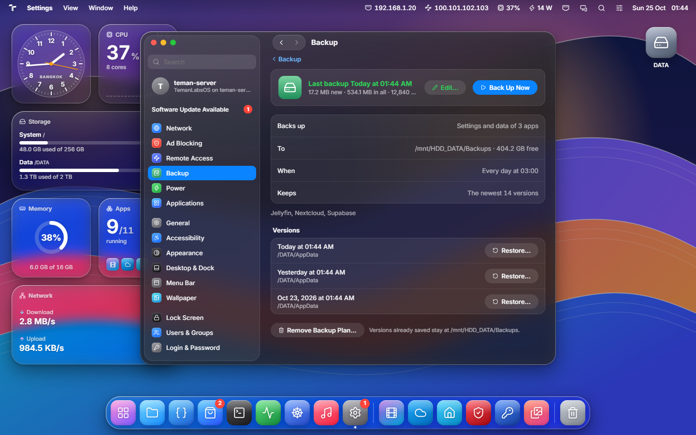<p align="center"><b>Backup</b>: apps and folders, with every version restorable</p></td>
    <td width="50%">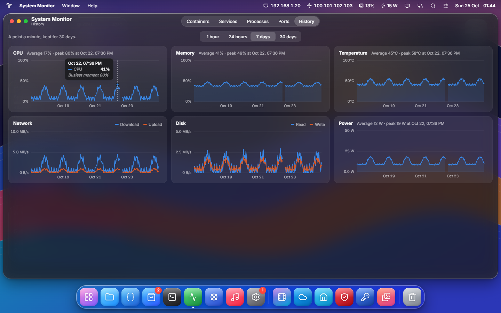<p align="center"><b>History</b>: 30 days of CPU, memory, temperature, network and disk</p></td>
  </tr>
  <tr>
    <td width="50%">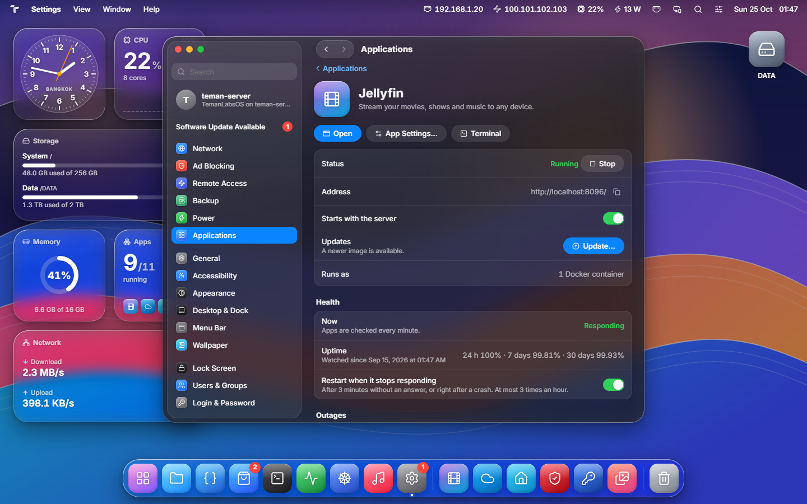<p align="center"><b>Applications</b>: health, uptime and auto-restart for every app</p></td>
    <td width="50%">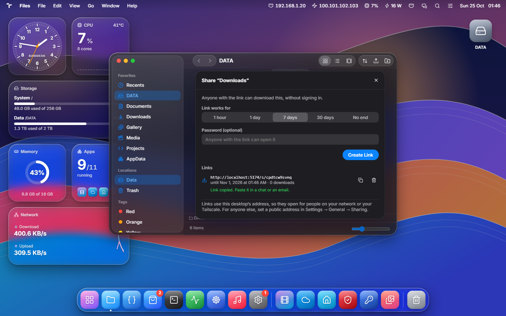<p align="center"><b>Share links</b>: a link to a file or folder, with an expiry</p></td>
  </tr>
  <tr>
    <td width="50%">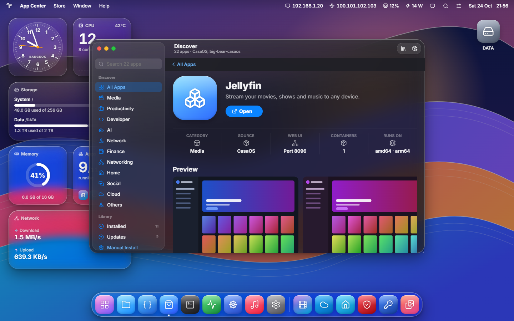<p align="center"><b>App Center</b>: every app has its own page</p></td>
    <td width="50%">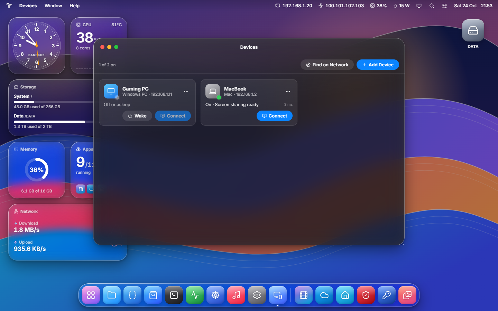<p align="center"><b>Devices</b>: Wake-on-LAN and remote screens</p></td>
  </tr>
  <tr>
    <td width="50%">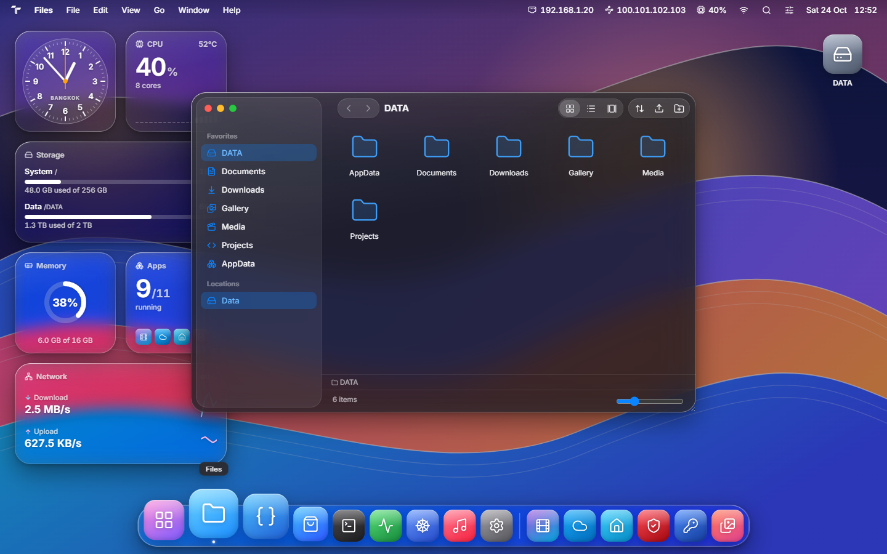<p align="center"><b>Files</b>: Recents, Trash and Tags in the sidebar</p></td>
    <td width="50%">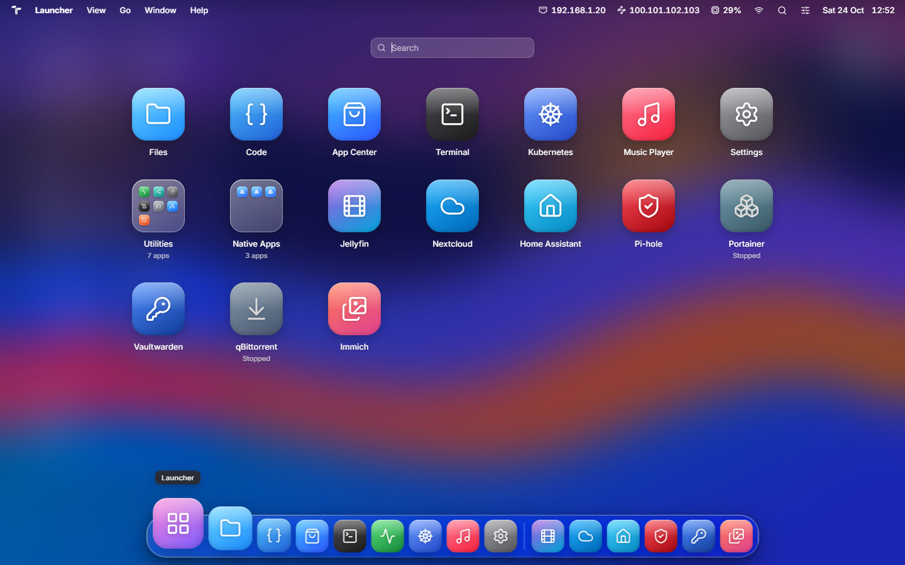<p align="center"><b>Launcher</b>: every app and folder</p></td>
  </tr>
  <tr>
    <td width="50%">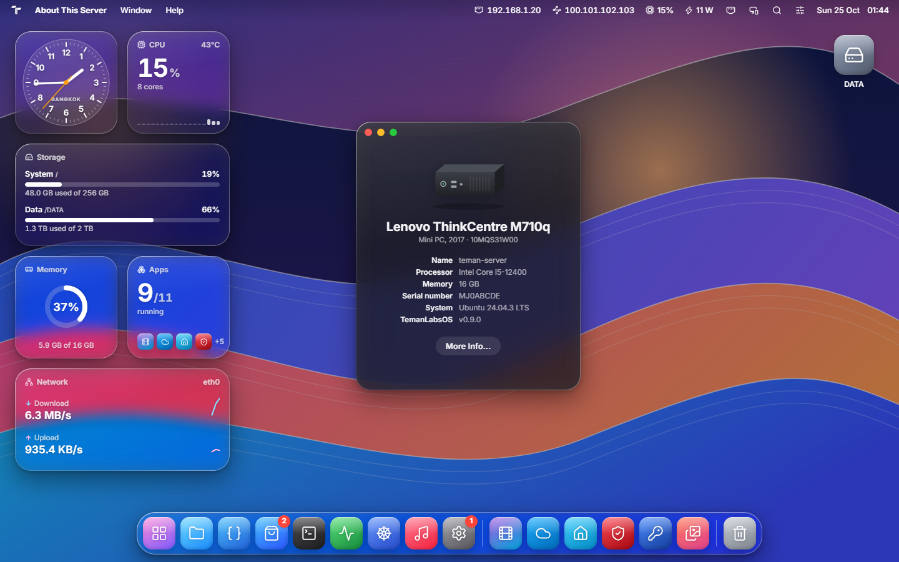<p align="center"><b>About This Server</b>: the machine, from its firmware</p></td>
    <td width="50%">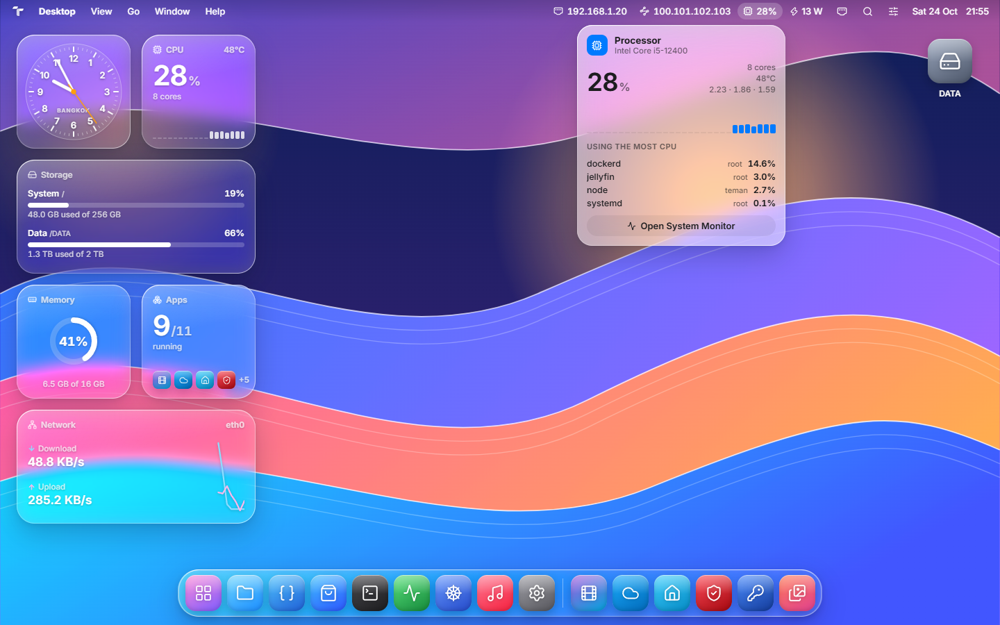<p align="center"><b>Light theme</b>: status bar panels and widgets</p></td>
  </tr>
  <tr>
    <td width="50%">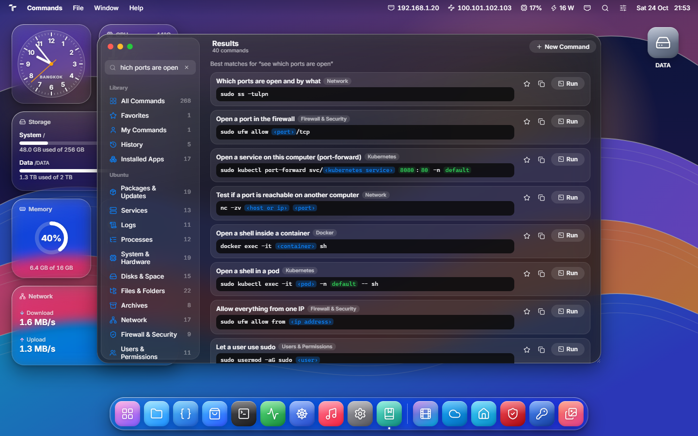<p align="center"><b>Commands</b>: find a command by describing it</p></td>
    <td width="50%">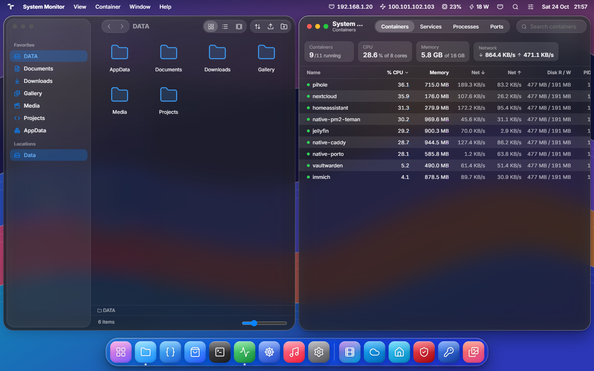<p align="center"><b>Snap</b>: windows side by side</p></td>
  </tr>
  <tr>
    <td width="50%">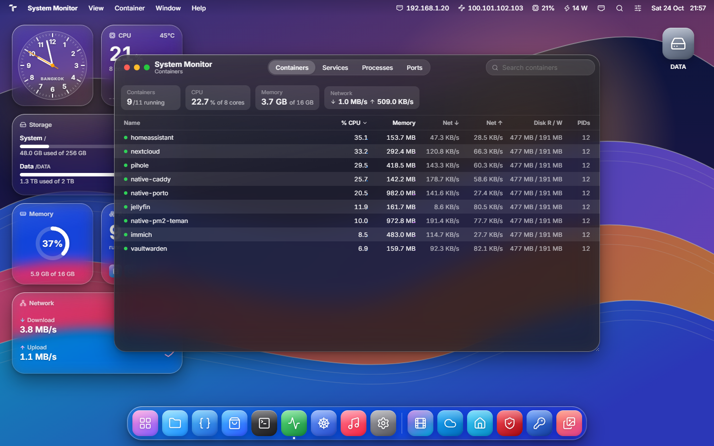<p align="center"><b>System Monitor</b>: statistics per container</p></td>
    <td width="50%">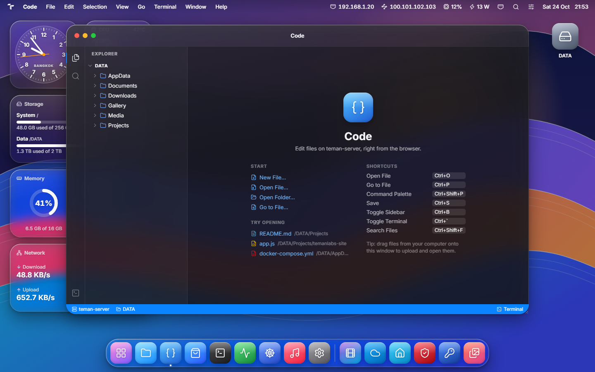<p align="center"><b>Code</b>: edit files on the server</p></td>
  </tr>
</table>

## Architecture

```
Browser ──HTTP/WebSocket──▶ temanlabsos (Go, systemd)
                              ├─ React frontend (embedded)
                              ├─ REST API /api/*  ·  WebSockets /ws/terminal, /ws/remote
                              ├─ share-link pages /s/* (no sign-in)
                              ├─ Docker Engine ──▶ app containers
                              ├─ per-app proxies ──▶ apps shown in windows
                              ├─ background: history, app health, backup schedule
                              ├─ guacd (container) ──▶ VNC / RDP to other computers
                              ├─ AdGuard Home (container) ──▶ DNS for the home
                              ├─ k3s / kubectl ──▶ Kubernetes cluster (optional)
                              └─ system tools: systemctl, journalctl, apt, ufw, smbd, lsblk, ffmpeg, rclone, restic…
```

<details>
<summary><b>Project layout</b></summary>

```
├─ src/                     Frontend (React + TypeScript)
│  ├─ App.tsx               The desktop: windows, Dock, Launcher, menu bar
│  ├─ api/                  httpApi.ts (server), mockApi.ts + mockSystem.ts (sample data), types.ts
│  ├─ components/           Window, Dock, Launcher, QuickSearch, MenuBar, Glass, widgets, dialogs
│  │  └─ settings/          Settings sections: server, desktop, applications, backup
│  ├─ windows/              Each app: Files, AppCenter, Devices, SystemMonitor, Terminal, …
│  ├─ hooks/  lib/          State, helpers, command library, settings
│  └─ styles/               base.css (theme tokens), glass.css (glass effect), app.css (layout)
├─ server/                  Go backend, one file per area (docker.go, backups.go, health.go, files.go, …)
├─ deploy/install.sh        systemd installer
├─ scripts/build-server.mjs Builds the frontend, embeds it and cross-compiles the Linux binary
└─ docs/                    Documentation and screenshots
```

</details>

How it works, and every API endpoint, is in **[docs/architecture.md](docs/architecture.md)**.

## Security

> [!WARNING]
> TemanLabsOS gives **full access to the server** (the service runs as root). Don't expose its port directly to the internet. Use it on your LAN, over a VPN (for example Tailscale), or behind a reverse proxy with HTTPS.

- **Sign-in**:
  - Passwords are hashed with PBKDF2-SHA256.
  - Session cookies are `HttpOnly` and `SameSite=Lax`, valid for 30 days. Every signed-in browser is listed in Settings and can be signed out.
  - An IP is locked out for a while after 8 failed sign-ins in 10 minutes.
  - The screen can lock by itself after a while away; a locked session can do nothing until it's unlocked.
- Cross-site requests are refused, and input is validated before it's used in a system command.
- Passwords for other computers' screens and for apps' own logins stay on the server (readable by root only); the browser never gets them back. Backups are encrypted with a key that only the server holds.
- **Share links** open only what was shared: paths can't leave the shared folder (not even through symlinks), hidden files stay hidden, and password tries are limited. They're reachable wherever TemanLabsOS is; use a separate public address for links you send outside.
- System folders, important users and important services are protected from being deleted or stopped through the UI.

## Documentation

| Document | Contents |
|---|---|
| Installation · [English](docs/installation.md) · [Bahasa Indonesia](docs/installation.id.md) | Requirements, install and update, configuration, development, troubleshooting |
| Architecture · [English](docs/architecture.md) · [Bahasa Indonesia](docs/architecture.id.md) | How the frontend and backend work, adding an app, the API endpoints |

## Credits

Built with [React](https://react.dev/), [Vite](https://vite.dev/), [Lucide](https://lucide.dev/), [Inter](https://rsms.me/inter/), [Monaco Editor](https://microsoft.github.io/monaco-editor/), [xterm.js](https://xtermjs.org/), [Apache Guacamole](https://guacamole.apache.org/), [restic](https://restic.net/), [rclone](https://rclone.org/), [AdGuard Home](https://adguard.com/adguard-home/overview.html), [coder/websocket](https://github.com/coder/websocket), [creack/pty](https://github.com/creack/pty), [k3s](https://k3s.io/), [yt-dlp](https://github.com/yt-dlp/yt-dlp), [gallery-dl](https://codeberg.org/mikf/gallery-dl), [streamlink](https://streamlink.github.io/) and [Simple Icons](https://simpleicons.org/). App icons from [selfh.st/icons](https://selfh.st/icons/). Block lists by [HaGeZi](https://github.com/hagezi/dns-blocklists) and [ABPindo](https://github.com/ABPindo/indonesianadblockrules).

TemanLabsOS is an independent project and isn't affiliated with any operating system vendor. Third-party app names and logos in the App Center belong to their owners.

## License

TemanLabsOS is released under the [MIT License](LICENSE). The tools and apps it installs keep their own licenses. Settings → Privacy & Terms on the server says what TemanLabsOS keeps, where it connects, and the terms of use.

<div align="center">
<br />
<sub>Made by <a href="https://github.com/diopratama99">Dio Pratama</a></sub>
</div>
